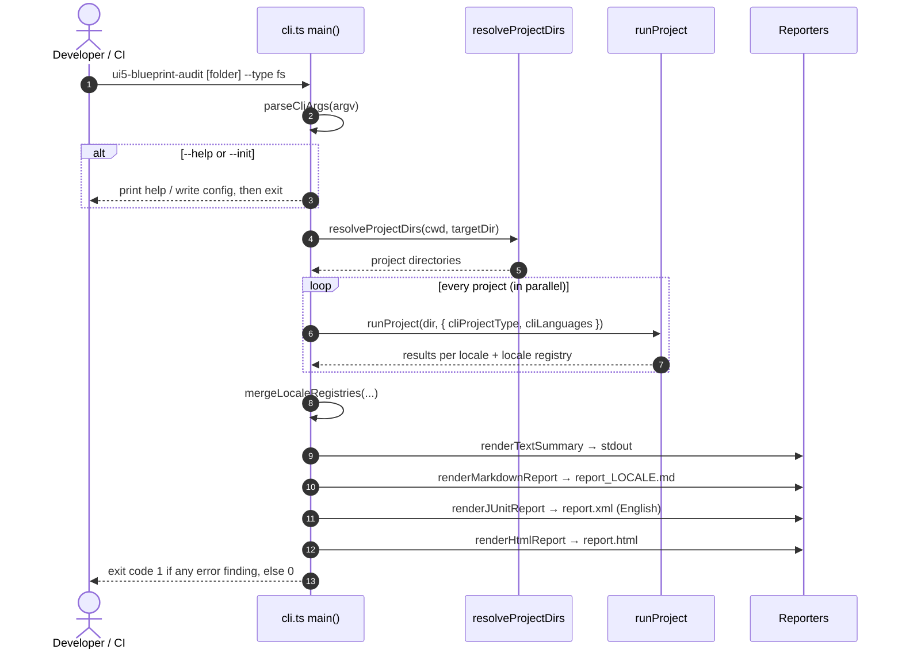
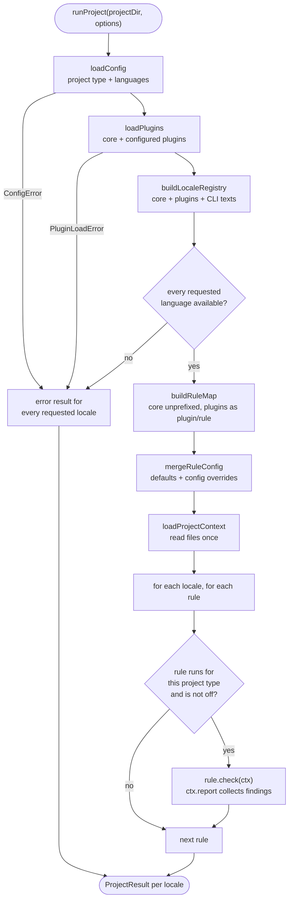

# Run flow

What happens when you run `npx @abap/ui5-blueprint-audit --type fs`.

## From command to exit code



## Step by step

| # | Step | Where |
|---|---|---|
| 1 | Parse the arguments. | [`parseCliArgs`](https://github.com/tobiashofmann/UI5-BlueprintAudit/blob/main/packages/ui5-blueprint-audit/src/cli.ts) |
| 2 | Handle `--help` and `--init`, which exit early. | [`main`](https://github.com/tobiashofmann/UI5-BlueprintAudit/blob/main/packages/ui5-blueprint-audit/src/cli.ts), [`writeDefaultConfig`](https://github.com/tobiashofmann/UI5-BlueprintAudit/blob/main/packages/ui5-blueprint-audit/src/cli.ts) |
| 3 | Find the projects to audit. | [`resolveProjectDirs`](https://github.com/tobiashofmann/UI5-BlueprintAudit/blob/main/packages/ui5-blueprint-audit/src/engine/resolve-project-dirs.ts) |
| 4 | Run each project end to end. | [`runProject`](https://github.com/tobiashofmann/UI5-BlueprintAudit/blob/main/packages/ui5-blueprint-audit/src/engine/run-project.ts) |
| 5 | Merge the locale registries of all projects. | `mergeLocaleRegistries` in [`-types`](https://github.com/tobiashofmann/UI5-BlueprintAudit/blob/main/packages/ui5-blueprint-audit-types/src/index.ts) |
| 6 | Print the summary, write the reports. | [`src/report/`](https://github.com/tobiashofmann/UI5-BlueprintAudit/tree/main/packages/ui5-blueprint-audit/src/report) |
| 7 | Set `process.exitCode`. | [`main`](https://github.com/tobiashofmann/UI5-BlueprintAudit/blob/main/packages/ui5-blueprint-audit/src/cli.ts), [`hasErrorFindings`](https://github.com/tobiashofmann/UI5-BlueprintAudit/blob/main/packages/ui5-blueprint-audit/src/engine/types.ts) |

## Step 3: find the projects

`resolveProjectDirs` decides what counts as a project. A folder with a `ui5.yaml` of type `application` or `library` is one project. A folder with a `webapp/manifest.json` is also one project. Anything else is a container, and each direct subdirectory becomes a project.

```ts
export function resolveProjectDirs(cwd: string, targetDir?: string): string[] {
  if (!targetDir) return [cwd];

  const root = resolve(cwd, targetDir);
  if (looksLikeProject(root)) return [root];

  return readdirSync(root, { withFileTypes: true })
    .filter((entry) => entry.isDirectory() && !entry.name.startsWith(".") && !IGNORED.has(entry.name))
    .map((entry) => resolve(root, entry.name))
    .sort();
}
```

## Step 4: run one project

`runProject` is the core of the tool.



A broken config or plugin does **not** throw. It becomes an error result for every requested language, so one broken project does not stop a multi-project run.

The heart of the function is the loop over locales and rules:

```ts
const resultsByLocale: ProjectResultsByLocale = {};
for (const locale of localesToRun) {
  const t = createTranslator(registry, locale);
  const results: RuleResult[] = [];
  for (const [ruleId, rule] of Object.entries(ruleMap)) {
    if (!rule.meta.projectTypes.includes(config.projectType)) continue;
    const entry = resolvedRules[ruleId];
    if (!entry || entry.severity === "off") continue;

    const findings: RuleResult["findings"] = [];
    await rule.check({
      projectContext,
      options: entry.options ?? {},
      t,
      report: (finding) => findings.push({ ...finding, ruleId, severity: entry.severity }),
    });

    results.push({ ruleId, description: t(rule.meta.descriptionKey), severity: entry.severity, findings });
  }
  resultsByLocale[locale] = { projectDir, projectName, projectType: config.projectType, results };
}
```

Three things to notice:

- The project context is loaded **once**, before the loop. Every locale re-runs the rules against the same context, only with a different translator.
- `en` always runs, even if it is not an active language, because `report.xml` is always English.
- The engine fills in `ruleId` and `severity` of each finding. A rule never sets them.

## Steps 6 and 7: reports and exit code

After all projects are done, `main` writes one Markdown report per active language, one JUnit file from the English results, and one HTML file with all languages. The exit code comes last:

```ts
process.exitCode = resultsByProject.some((r) => Object.values(r).some(hasErrorFindings)) ? 1 : 0;
```

`hasErrorFindings` returns `true` if a project failed to load, or if a rule with severity `error` has at least one finding. Rules with severity `warn` never change the exit code.
