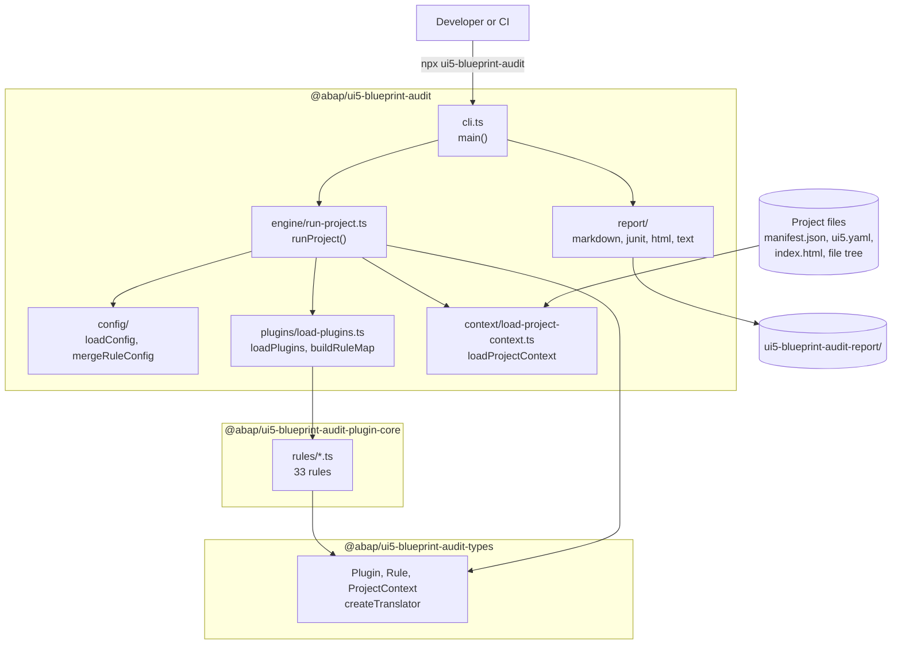

# Architecture

This section is for people who work on BlueprintAudit or want to understand how a run works. It links to the source and shows the important code.

## The big picture



## Key decisions

| Decision | Reason |
|---|---|
| **Standalone CLI.** Not an ESLint plugin, not a plugin for `@ui5/linter`. | The rules check project structure, manifest, and config files, not single source files. |
| **TypeScript on Node.js, ESM.** | One language across all three packages. |
| **Monorepo with npm workspaces.** | Three packages with a clear dependency direction: `types` ← `plugin-core` ← CLI. |
| **The core rules are a regular plugin.** | The plugin mechanism gets exercised by the product itself. There is no special path for built-in rules. |
| **A project context, loaded once.** | Rules never touch the file system. They are fast and easy to test. |
| **The user states the project type.** | No auto-detection. A rule runs only for the types in the catalog. |
| **YAML config.** | Comments are explicitly wanted. |
| **The catalog is the source of truth.** | If code and catalog disagree, the catalog wins. |

## Repository layout

```text
packages/
  ui5-blueprint-audit/               CLI, config, plugin loader, engine, reports
  ui5-blueprint-audit-plugin-core/   33 rules, locales, helpers
  ui5-blueprint-audit-types/         plugin contract, translation helpers
docs/                                this site, the rule catalog, notes
sample-prj/                          reference projects (regression source of truth)
scripts/                             SBOM generation
.github/workflows/                   ci.yml, release.yml
```

## Where to go next

- [Run flow](/dev/flow): what happens from `npx` to the exit code
- [Project context and rules](/dev/context-and-rules): how rules read the project
- [Plugins and localization](/dev/plugins-and-locales): loading plugins, translating messages
- [Testing and releases](/dev/testing): tests, sample projects, and the release workflow
