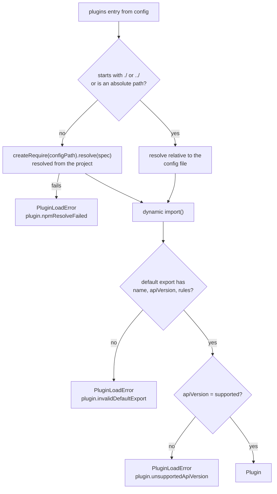
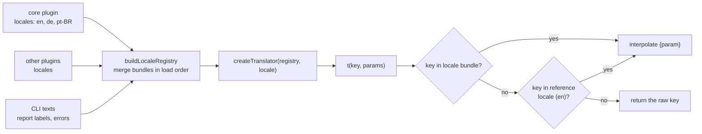

# Plugins and localization

## Loading plugins

`runProject` calls [`loadPlugins`](https://github.com/tobiashofmann/UI5-BlueprintAudit/blob/main/packages/ui5-blueprint-audit/src/plugins/load-plugins.ts) with the `plugins` list from the config. The core plugin is always loaded first.



The two branches are the key part of `loadOnePlugin`:

```ts
if (isLocalSpecifier(spec)) {
  moduleUrl = pathToFileURL(resolve(dirname(configPath), spec)).href;
} else {
  const require = createRequire(configPath);
  let resolved: string;
  try {
    resolved = require.resolve(spec);
  } catch {
    throw new PluginLoadError(
      "plugin.npmResolveFailed",
      { spec },
      `Plugin "${spec}" could not be resolved from the project directory.`,
    );
  }
  moduleUrl = pathToFileURL(resolved).href;
}

const imported = (await import(moduleUrl)) as { default?: unknown };
return validatePlugin(spec, imported.default);
```

Local paths resolve relative to the config file. npm packages resolve from the project, not from the folder of the audit tool. The supported plugin API version is `"1"`.

## Rule IDs and namespacing

[`buildRuleMap`](https://github.com/tobiashofmann/UI5-BlueprintAudit/blob/main/packages/ui5-blueprint-audit/src/plugins/load-plugins.ts) flattens all plugins into one map. The first plugin (core) keeps bare IDs. Every other plugin gets a `<plugin>/<rule>` prefix:

```ts
plugins.forEach((plugin, index) => {
  const prefix = index === 0 ? "" : `${plugin.name}/`;
  for (const [ruleId, rule] of Object.entries(plugin.rules)) {
    map[`${prefix}${ruleId}`] = rule;
  }
});
```

## Rule configuration

[`mergeRuleConfig`](https://github.com/tobiashofmann/UI5-BlueprintAudit/blob/main/packages/ui5-blueprint-audit/src/config/merge-rule-config.ts) starts from each rule's `defaultSeverity` and applies the overrides from the config. A config entry is either a severity or `[severity, options]`:

```ts
function normalize(value: RuleConfigValue): RuleConfigEntry {
  if (Array.isArray(value)) {
    const [severity, options] = value;
    return { severity, options };
  }
  return { severity: value };
}
```

## Localization

Every text a user can see goes through a translator. The pieces live in [`-types`](https://github.com/tobiashofmann/UI5-BlueprintAudit/blob/main/packages/ui5-blueprint-audit-types/src/index.ts):



`createTranslator` is short:

```ts
export function createTranslator(registry: LocaleRegistry, locale: LocaleCode): Translator {
  return (key, params) => {
    const template = registry.bundles[locale]?.[key] ?? registry.bundles[registry.referenceLocale]?.[key] ?? key;
    return interpolate(template, params);
  };
}
```

### Bundles in the repository

- Rule messages: [`packages/ui5-blueprint-audit-plugin-core/src/locales/`](https://github.com/tobiashofmann/UI5-BlueprintAudit/blob/main/packages/ui5-blueprint-audit-plugin-core/src/locales/en.ts)
- Report labels and error texts: [`packages/ui5-blueprint-audit/src/locales/`](https://github.com/tobiashofmann/UI5-BlueprintAudit/blob/main/packages/ui5-blueprint-audit/src/locales/en.ts)

`en.ts` is the source of truth for the key names. `de.ts` and `pt-BR.ts` are typed as `Record<keyof typeof en, string>`, so a missing key is a **build error**:

```ts
const de: Record<keyof typeof en, string> = {
  "typescript.description": "Das Projekt verwendet TypeScript.",
  // ...
};
```

A test in each package also checks that all languages have the same keys.

### Output languages

| Output | Languages |
|---|---|
| `report_LOCALE.md` | One file per active language |
| `report.xml` | Always English, so CI dashboards stay stable |
| `report.html` | One file with all active languages and a switcher |
| Console summary | The first active language |

To add a language without changing the repository, ship it as a [plugin with `locales`](/concepts/own-rules#add-a-language).
