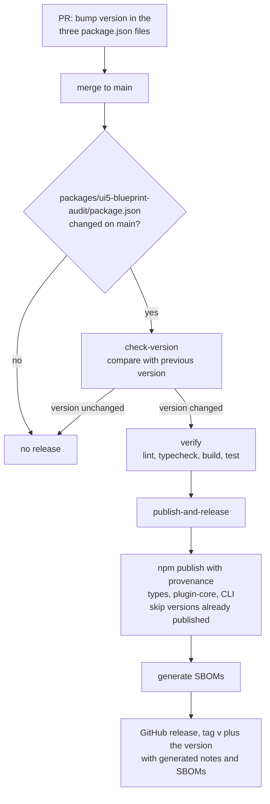

# Testing and releases

## Run the checks

```bash
npm run lint
npm run typecheck
npm run build
npm test
```

CI runs the same commands on every pull request. See [`.github/workflows/ci.yml`](https://github.com/tobiashofmann/UI5-BlueprintAudit/blob/main/.github/workflows/ci.yml).

| Script | Purpose |
|---|---|
| `npm test` | Runs the unit and integration tests with Vitest. |
| `npm run test:coverage` | Runs the tests with a V8 coverage report. |
| `npm run mutation` | Runs mutation tests with Stryker. |
| `npm run test:allure`, `npm run report:allure` | Writes an Allure report. |
| `npm run test:junit` | Writes JUnit XML to `test-results/`. |
| `npm run docs:api` | Generates the TSDoc API reference with TypeDoc into `docs/api/`. |
| `npm run sbom` | Generates CycloneDX SBOMs. |

## What is tested

- **Every rule has tests** with small fixtures: one valid and one invalid case, for each project type the rule applies to. The tests sit next to the rule, for example `rules/theme.test.ts`.
- **The engine and the loaders** have tests next to their source: config loading, rule merging, plugin loading, project directory resolution, and `runProject`.
- **The reporters** have tests for Markdown, JUnit, HTML, and the text summary.
- **Locale parity**: a test per package checks that `de` and `pt-BR` have the same keys as `en`.

## Sample projects

[`sample-prj/`](https://github.com/tobiashofmann/UI5-BlueprintAudit/blob/main/sample-prj) holds reference projects. They are the regression source of truth.

| Project | Purpose |
|---|---|
| `prj-valid` | A project that passes the checks. |
| `prj-violations-1`, `prj-violations-2` | Purpose-built projects with violations. |
| `prj-js`, `prj-ts` | Unmodified `@sap/generator-fiori` scaffolds (JavaScript and TypeScript). |
| `prj-js-flp-plugin`, `prj-ts-flp-plugin` | Unmodified scaffolds of Fiori Launchpad plugins. |
| `prj-ts-lib` | A library. |

[`sample-projects.test.ts`](https://github.com/tobiashofmann/UI5-BlueprintAudit/blob/main/packages/ui5-blueprint-audit/src/integration/sample-projects.test.ts) runs all 33 core rules against each project and compares the result with the table in [`sample-prj/testcases.md`](https://github.com/tobiashofmann/UI5-BlueprintAudit/blob/main/sample-prj/testcases.md). If you change a rule or a fixture, the test fails until the table matches the actual state. When you change the engine or a rule, check these projects first.

Try the audit on them from the repository root:

```bash
npm run build
node packages/ui5-blueprint-audit/dist/cli.js sample-prj/prj-violations-1 --type fs --lang en
```

## Releases

A release is a version bump merged to `main`.



The workflow is [`.github/workflows/release.yml`](https://github.com/tobiashofmann/UI5-BlueprintAudit/blob/main/.github/workflows/release.yml). The steps:

1. Create a branch, bump `version` in all three packages, and update the pinned cross-dependencies to match.
2. Merge the pull request to `main`. `main` is protected, so changes only land through a pull request.
3. The workflow runs the full check, publishes the packages in the order `types`, `plugin-core`, CLI, and creates the GitHub release with the tag `v<version>`.

You do not create the tag or the release by hand. A push to `main` that does not change the version in `packages/ui5-blueprint-audit/package.json` does not release.

npm authentication uses [Trusted Publishing](https://docs.npmjs.com/trusted-publishers) (OIDC), so there is no `NPM_TOKEN` secret.

## Work on this documentation

```bash
npm run docs:dev       # live preview with hot reload
npm run docs:build     # production build into docs/.vitepress/dist
npm run docs:preview   # serve the production build
```

The site is built with [VitePress](https://vitepress.dev) and [Mermaid](https://mermaid.js.org) for the diagrams. The pages are Markdown files in `docs/`. The rules table and the full catalog are **included** from [`docs/ui5-blueprint-audit-rules.md`](https://github.com/tobiashofmann/UI5-BlueprintAudit/blob/main/docs/ui5-blueprint-audit-rules.md), so the catalog stays the only place where rules are described. The table between the `overview` region markers of that file is the one the site shows. Keep the markers when you edit the table.
