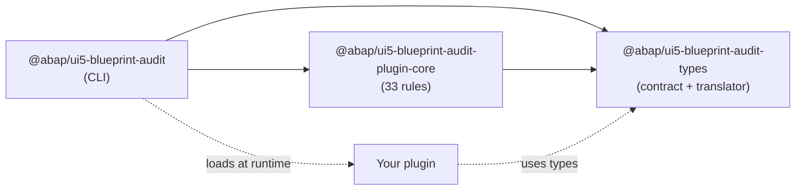

# Packages

BlueprintAudit is a monorepo with three npm packages. They share one scope, `@abap`.

| Package | Role |
|---|---|
| [`@abap/ui5-blueprint-audit`](/packages/audit) | The CLI: config loader, plugin loader, engine, and report writers. |
| [`@abap/ui5-blueprint-audit-plugin-core`](/packages/plugin-core) | The 33 default rules, built as a regular plugin. |
| [`@abap/ui5-blueprint-audit-types`](/packages/types) | The plugin contract and the translation helpers. |

You install **only the CLI**. It pulls in the other two. Install `-types` yourself only when you write a plugin in TypeScript.

## Publish order

The three packages pin each other with exact versions. The release workflow publishes `types`, then `plugin-core`, then the CLI, so every dependency is on the registry before the package that needs it. See [Testing and releases](/dev/testing#releases).
